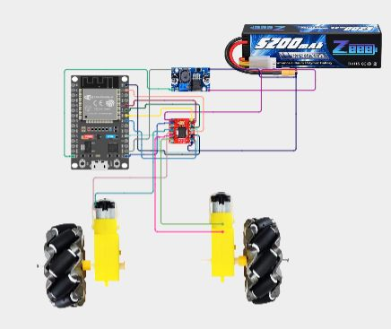
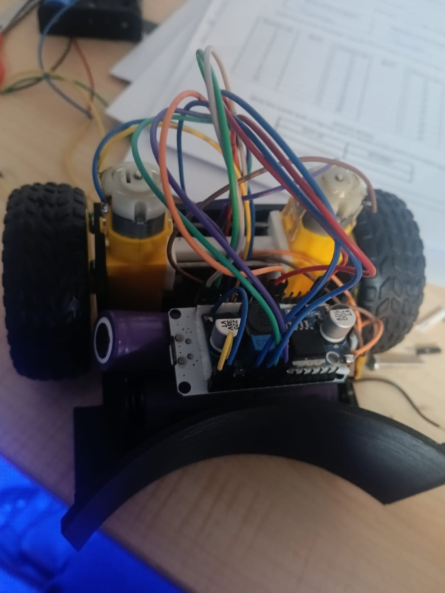

# RC Robo Soccer Car

Here is a full breakdown of how I designed, connected, and built my RC Robo Soccer Car. Including the circuit diagram, components list, CAD Models, Assembly and Code required to make a small two wheeled robot to play Robo Soccer.

Overall the aim of this project was to create a small robot that could roam around the soccer pitch using two BO Motors. The robot uses an ESP32 as its main controller, a TB6612FNG Motor Driver to control the motors and a ball caster at the front of the robot.

I wanted to keep everything as simple as possible, light and small.

## Features

Mini 2 wheeled robot soccer car
Main controller: ESP32
2 Motors: BO geared DC
Motor Driver: TB6612FNG Dual Motor Driver
Ball caster for front
Custom Chasis: 3D Printed
Powered via battery
Wireless control via bluetooth (planned)
Move forwards and backwards
Move left and right
Custom CAD design for component placement
Small electronics layout
Easy to assemble

## BOM – Bill of Materials

## Bill of Materials (BOM)

| Component | Quantity | Price (USD) | Purchase Link |
|---|---:|---:|---|
| ESP32 Dev Board | 1 | $3.96 | [Buy](https://robu.in/product/esp-wroom-32-wifi-bluetooth-networking-smart-component-development-board/) |
| TB6612FNG Motor Driver | 1 | $1.45 | [Buy](https://robu.in/product/motor-driver-tb6612fng-module-performance-ultra-small-volume-3-pi-matching-performance-ultra-l298n/) |
| TT Dual Shaft DC Motor | 2 | $1.27/pc | [Buy](https://robu.in/product/230rpm-straight-type-dual-side-6v-bo-motor/) |
| 65mm Wheels | 2 | $0.25/pc | [Buy](https://robu.in/product/robot-smart-car-wheel-tyre-bo-motor/) |
| 18650 Li-ion Battery | 2 | $1.45/pc | [Buy](https://robocraze.com/products/18650-2200mah-3-7v-battery-cylinder-type-blue) |
| 18650 Battery Holder | 1 | $0.26 | [Buy](https://robu.in/product/black-plastic-storage-box-case-holder-battery-3-x-18650-cell-box-without-cover/) |
| LM2596S Buck Converter | 1 | $0.44 | [Buy](https://robu.in/product/lm2596s-dc-dc-buck-converter-power-supply/) |
| Screws/Nuts/Spacers | As required | $4–$5 | Local Hardware Store |
| 3D Printed Parts | 12 | Self Printed | Self Printed |
| **Total** | | **$16.05–$17.05** | |

## Circuit Diagram

This circuit uses an ESP32 and a TB6612FNG motor driver to control the two BO motors.

The motor driver takes the directional signal and PWM signal from the ESP32. The battery powers the motor driver.

I designed this circuit with a ‘wire’ method rather than designing a custom PCB. This made it easier to connect things directly.

## Main Connections

**ESP32 → TB6612FNG**

| TB6612FNG | ESP32 |
|-----------|-------|
| AIN1 | GPIO 25 |
| AIN2 | GPIO 26 |
| PWMA | GPIO 27 |
| BIN1 | GPIO 32 |
| BIN2 | GPIO 33 |
| PWMB | GPIO 14 |
| STBY | GPIO 13 |
| VCC | 3.3V |
| GND | GND |

**TB6612FNG → Motors**

| TB6612FNG | Motor |
|-----------|-------|
| AO1 / AO2 | Left BO Motor |
| BO1 / BO2 | Right BO Motor |

**Power Connections**

- Battery positive → VM on TB6612FNG
- Battery negative → GND
- ESP32 and motor driver grounds must be connected together
- ESP32 should receive power through a suitable regulated supply

The motor supply voltage should remain within the ratings of the motors and driver.

## How to Build This...

Step 1:

Gather all your components from your BOM. The main components will be the ESP32, two BO motors, TB6612FNG motor driver, wheels, ball caster wheel and battery.

Step 2:

Begin by designing your robot chassis in fusion 360. Insert your components into CAD to get an idea of the size.

Step 3:

Attach the two BO motors to each side of the chassis. Attach the wheels and add the ball caster wheel to the front so it can freely spin.

Step 4:

Modify your chassis design to fit the space you have. Ensure there is enough space for the ESP32, motor driver, battery and wiring.

Step 5:

Export your CAD parts and 3D print. Ensure the motor mount holes are appropriate and there is good clearance between the components.

Step 6:

Attach the BO motors and wheels to the chassis. Ensure the motors fit and that the chassis is strong enough.

Step 7:

Connect the ESP32 to the TB6612FNG using the connection table above. Connect the motors to the motor driver outputs.

Step 8:

Connect the battery to the motor drivers VM input. Ensure the ESP32 has a suitable regulated power supply. Connect all the grounds together.

Step 9:

Upload the motor code to the ESP32. Test the motors one by one to ensure they work in the right direction (forward, reverse and spinning).

Step 10:

Secure the battery holder and electronics. Ensure no wires are in the way of the wheels.

## CAD Design and Modelling

I designed the chassis using Fusion 360.

The first thing I did was import the components that would be used such as the two BO Motors and the ESP32. This would give me an idea on how much space I had and where I should place my components.

I opted for a two motor system with a ball caster wheel. This kept things simple but allowed the robot to move and turn.

I modified some measurements and component placements to get everything to fit.

For the first print I had some issues with tolerances and one section wasn’t strong enough when putting everything together. I modified my design in fusion 360 and printed the new version.

[image](./images/cad.png)

## Circuit Design

For the electronics, I initially considered designing a PCB in KiCad. However, since the robot uses a relatively small number of components, I decided to use direct wiring instead.

The main electronics consist of:

- ESP32 as the main controller
- TB6612FNG for motor control
- Two BO motors
- Battery pack for power

I initially considered using a LiPo battery during circuit planning because I couldn't find the 18650 cells at that time. For the final assembly, I decided to use two 18650 cells instead.

The circuit is kept simple to make troubleshooting and future modifications easier.

## Code

The ESP32 is responsible for controlling the movement of the robot.

The motor driver receives direction signals and PWM values from the ESP32 to control the speed and direction of each motor.

The main control code includes:

- ESP32 GPIO control
- PWM-based motor speed control
- Forward movement
- Backward movement
- Left turning
- Right turning
- Motor stopping
- Individual motor control

**Main Motor Control Pins:**

| Function | ESP32 GPIO |
|----------|------------|
| Right Motor Direction 1 | GPIO 25 |
| Right Motor Direction 2 | GPIO 26 |
| Right Motor PWM | GPIO 27 |
| Left Motor Direction 1 | GPIO 32 |
| Left Motor Direction 2 | GPIO 33 |
| Left Motor PWM | GPIO 14 |
| Standby | GPIO 13 |

(Add the final ESP32 source code here)

## Assembly and Testing

After completing the initial CAD design and circuit planning, I started assembling the actual robot.

I first printed the chassis and checked how the components fitted. The first version had some tolerance problems, so I modified the design and printed it again.

During assembly, I mounted both BO motors and checked their fit. I then connected the motor driver, ESP32 and battery and tested the motors using basic code to make sure the connections were working properly.

After that, I arranged the electronics in the rear section of the robot. I soldered the required connections, removed unnecessary jumper wires and glued the battery holder to the bottom of the chassis.

The updated printed chassis fits the motors properly and keeps the main components together.

**Assembly Images:**

## Known Issues and Improvements

1. Multiple design changes were required to the chassis due to tolerance problems
2. Some 3D printed parts weren't strong enough initially
3. Motor rotation is based on how the BO motors are wired up
4. The speed could vary between the two BO motors even with the same PWM values.
5. The battery voltage could influence how the motors perform.
6. The electronics need to be attached securely.
7. The measurements for the chassis might need more adjustments.
8. The wiring needs to be done carefully so that it doesn't cause any problems with the wheels.
9. The speed and turning of the motors might need to be changed.
10. The wireless control and playing the game still needs to be done.

## Working Principle

The ESP32 acts as the main controller and sends direction and speed signals to the TB6612FNG motor driver.

The motor driver then controls the two BO motors independently, allowing the robot to move forward, backward and turn.

The basic control flow is:

ESP32  
↓  
Direction and PWM Signals  
↓  
TB6612FNG Motor Driver  
↓  
Left and Right BO Motors  
↓  
Wheels Rotate  
↓  
Robot Moves and Turns

By controlling the two motors independently, the robot can change its direction and navigate around the playing field.

## Final Result

A mini robot soccer car using two BO motors and an ESP32.

Designing the chassis so that it was compact yet still held all components required was one major challenge faced. The CAD was altered many times and some parts were reprinted to get a good fit.

Once the electronics were put together they were soldered and tested with basic code to control the motors.

Now the wireless controls need to be completed and the robot tested.

Overall, this project has given me hands-on experience with CAD modelling, 3D printing, motor drivers, ESP32 coding, circuit design and assembly.
